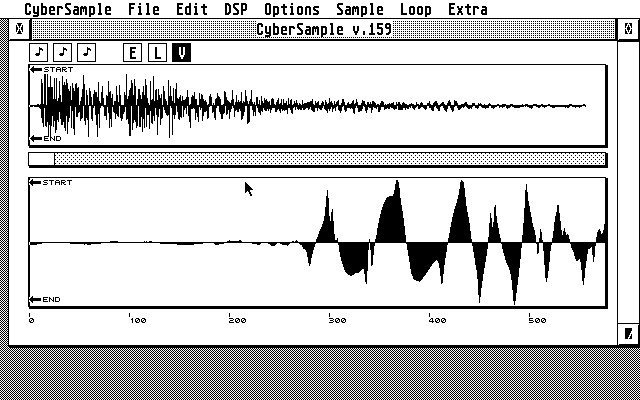

# CyberSample ST

A MIDI graphic sample editor for the **Atari ST**, written in C in 1993 and **revived in 2026**: it builds again
from the original source, runs in the [Hatari](https://hatari-emu.org/) emulator, and now imports **WAV files natively**.



## What it is

A window-based sample editor for Atari ST / STe / Falcon class machines (colour and mono):

- 8 sample slots plus an undo slot; sample size limited only by free RAM
- Import/export over MIDI using the **MIDI Sample Dump Standard** (8–20 bit in, 12 bit out), tested originally on a Yamaha TX16W
- Load/save Sound Designer `.SD` files, ADAP `.SND` files, raw data, the GEM clipboard — and now **WAV**
- Zoom, markers, a loop point pair, an edit-block pair; cut/copy/paste (insert, replace, merge, multiples)
- DSP menu: truncate, invert, ±6 dB, reverse, clear, "Mirage" (4-bit grunge), fade in/out, normalise
- Launch other programs from inside the editor

The original program notes are in [`docs/history/`](docs/history/).

## What's new in this revival

| | |
|---|---|
| **Builds again** | Compiles with HiSoft's Lattice C 5.60 after a handful of compatibility shims ([porting notes](docs/porting-notes.md)) |
| **Native WAV import** | `File > Raw Data…` auto-detects RIFF/WAVE: 8/16/24-bit PCM, any rate, left channel of multi-channel files ([details](docs/wav-import.md)) |
| **Bug fix** | A 1993 bug that broke every file open outside the program's own folder when run from a hard drive |
| **Headless CI build** | `ci/build.sh` compiles and links the whole program from the command line in ~1.5 minutes ([how it works](docs/ci.md)) |

## Building

The toolchain is **Lattice C 5.60 (HiSoft)**, which is commercial software and is **not included** in this repository.
Point the build at your own copy of the Lattice install (the folder containing `BIN`, `H`, `HEADERS`, `LIB`):

```sh
sudo apt install hatari xvfb python3 curl unzip      # Debian/Ubuntu
ci/build.sh --lattice /path/to/LatticeC              # -> out/CYBR160.PRG
```

It downloads the open-source [EmuTOS](https://emutos.sourceforge.io/) as the operating system, so no Atari ROM is needed either.
Building inside the Lattice IDE also works — see [`docs/porting-notes.md`](docs/porting-notes.md).

## Running

Mount a folder as drive C: in Hatari (`--harddrive`), in **ST high resolution (mono)**, and run `CYBR160.PRG`.
Then `File > Raw Data…` and pick a `.wav` file.

## Repository layout

```
src/        program source, Lattice project file (CYBR160.PRJ), WERCS resource files
docs/       porting notes, WAV import notes, CI notes, original 1993 documents (docs/history)
patches/    diffs of every change made to the 1993 sources
ci/         headless build: build.sh, project->command-file generator, the RUNCMD helper (source + built .TOS)
tests/      host-side unit tests (tests/run.sh: gcc only): DSP routines and Cut/Copy, run on code extracted from src/
tests/midi/ MIDI loopback test: the real program in Hatari talking SDS to a virtual sampler (docs/midi-loopback.md)
attic/      scratch files from the original source tree, kept for history
```

## Status / ideas

Builds and runs; loading and displaying samples verified. **Not yet exercised** in the revival: playback and MIDI sample dump
(no MIDI hardware in the emulator setup). Ideas: a dedicated *File > WAV…* menu entry (needs a resource edit), WAV export,
stereo handling, rebuilding the older `CYBR159` tree and the CYBRWAVE tool.

## License

[MIT](LICENSE).
